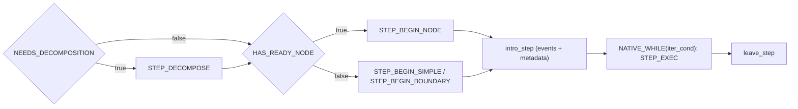

# The Step Loop

The built-in `ReActAgentStrategy` runs as a **node-driven Step loop**: the LLM
decides the plan, the framework walks it, and everything is observable and
interruptible.

## Enabling the Step Loop

The Step loop is **opt-in** — the default `ChatObject` workflow
(`_workflow_rendered`) runs the full shell with the **legacy single-call agent
loop** on its agent branch (one `single_execute` per round, no decomposition).
Enable the Step loop by passing the step-loop workflow explicitly:

```python
from amrita_core.chatmanager import _step_workflow_rendered

chat = agent.get_chatobject(
    "Plan and run the migration", workflow=_step_workflow_rendered
)
```

or use the full pre-composed pipeline:

```python
from amrita_core.builtins.workflows import SIMPLE_STEP_REACT

chat = agent.get_chatobject("Plan and run the migration", workflow=SIMPLE_STEP_REACT)
```

> `Agent.get_chatobject(user_input, **kwargs)` forwards `workflow` (and any
> other `ChatObject` option) straight through. The `update_step` tool and the
> `step_*` metadata events only exist while the step-loop workflow is active.

## Anatomy of a Step

A Step boundary is not an `if` in the strategy: decomposition, selection,
opening and plan publication are each a node on `STEP_BODY`, separated by
`NATIVE_IF` predicates.



| Phase | What happens |
| --- | --- |
| **NEEDS_DECOMPOSITION / STEP_DECOMPOSE** | First Step: the LLM decides simple vs DAG `{needs_decomposition, dag, reason}`; a failed call degrades to simple |
| **HAS_READY_NODE / STEP_BEGIN_NODE** | Picks the next ready DAG node in topological order and opens it as the current Step |
| **USES_SIMPLE_STEP / STEP_BEGIN_SIMPLE** | Bare run: one implicit `execute` Step |
| **PLAN_EXHAUSTED / STEP_BEGIN_BOUNDARY** | Plan finished or blocked on deps: opens a `verify` boundary Step |
| **STEP_PLAN_STATUS** | Injects the plan snapshot when it changed (idempotent) |
| **intro_step** | Drains peer messages; emits the `step_intro` event + metadata |
| **STEP_EXEC** | One `single_execute()` round: model -> tools -> results; `after_iteration()` runs stall detection _inside_ the loop |
| **leave_step** | Summarizes (subject-predicate, failure goes through `Try`'s catch branch), completes the node, compresses history; emits `step_leave` |

The predicates and actions live in `components/step_nodes.py`;
`intro_step` stays as an equivalent direct-call entry point (same functions),
so custom strategies and unit tests do not need an interpreter.

## Semantic State: `AgentRunState`

All step-level state lives in `AgentRunState` (bridged between
`AgentLoopState.run_state` and `strategy.run_state` — **one instance**):

| Field                               | Meaning                                                           |
| ----------------------------------- | ----------------------------------------------------------------- |
| `step_index`                        | Global step counter                                               |
| `decomposition_done`                | The first decompose decision already ran (re-entry guard)         |
| `open_step_index`                   | `step_index` of the opened Step (graph node / intro de-dup mark)  |
| `current_phase` / `current_step_id` | The active DAG node                                               |
| `plan` / `completed_step_ids`       | The task DAG + progress                                           |
| `step_tool_signatures`              | Tool signatures in the current Step (stall window)                |
| `stall_injected`                    | Give-up prompt injected (once per Step)                           |
| `tool_error_hints`                  | Hard ERROR tool results seen in this Step (retry->revise guidance) |
| `last_summary`                      | Subject-predicate summary of the previous Step                    |
| `tokens`                            | Real API token accounting (compression trigger)                   |
| `exec_finished`                     | Strategy done calling tools -> iteration loop ends                 |
| `step_started_ts`                   | Wall-clock start of the Step (token-budget window anchor)         |

## Stall Protection

1. **`_should_cancel_tool_call`** — before executing, the N-th identical
   signature is cancelled and returns `"Cancelled: Reach the max limit of
repeatly calling tool."`
2. **`after_iteration`** — per-iteration hook (inside the loop!) injects the
   give-up prompt when the window repeats; sets `stall_injected`/`exec_finished`
   so `iter_cond` stops the loop immediately — no more tokens burned.

> Historical lesson: stall detection must run **inside** the loop
> (`after_iteration`), not at `leave_step` (outside) — otherwise a stuck agent
> never reaches the detector.

## Lifecycle Events

| Event                  | When                  | Mutable                             |
| ---------------------- | --------------------- | ----------------------------------- |
| `agent.step_intro`     | Step starts           | `override_phase`                    |
| `agent.step_leave`     | Step ends             | `override_verb` / `override_object` |
| `agent.step_iteration` | Each tool round       | `end_step`                          |
| `agent.tool_call`      | Before a regular tool | `arguments` / `cancel`              |
| `agent.tool_return`    | After a regular tool  | `result` / `skip_append`            |

Matchers may mutate events or raise `StepAbortError` (control flow). Built-in
tools (REASONING / UPDATE_STEP / STOP) do not fire events.

## Between-Step History Management

The step loop acts on the history when the prompt tokens the provider reported
for the current Step exceed the threshold (`ContextCompactor.threshold` = the
preset's attention window × `llm.compaction_trigger_ratio`). It reads the same
`llm.context_strategy` as the between-turn handling, and both read the threshold
from one source, so one number describes one model.

Under `"compact"` the folded prefix is replaced by a single `user` message
(`[Summary of previous steps]\n<summary>`) followed by the retained tail. Under
`"slide"` the oldest messages are dropped outright and no model call is made.
Either way the cut lands on a `user` message, so every `assistant(tool_calls)`
stays next to its `ToolResult` and the remaining context is still well-formed. A
failed or empty summary, or a slide that could not find a safe boundary, leaves
the history untouched; either way the token baseline resets, so there is no
retry loop. The `compress` step metadata carries the triggering token count and
the threshold.

## Step Metadata

Emitted as `MessageWithMetadata` (`type="step"`):

| `extra_type` | Content                                          |
| ------------ | ------------------------------------------------ |
| `decompose`  | decision, DAG ids + descriptions, reason         |
| `intro`      | phase, step_index, simple_mode, node description |
| `leave`      | phase, stall flag, summary verb/object           |
| `stall`      | the repeated signatures, injected flag           |
| `compress`   | prompt tokens, threshold                         |

## The `update_step` Tool

The agent can revise the plan mid-run: `replan` (replace DAG), `mark_done`,
`add_step`, `remove_step`. Each revision bumps `plan_revision`; execution stays
linear (the DAG is a semantic layer, not a parallel graph).

## Peer Messages

`intro_step` drains the reverse stream (`send_to_producer`) and appends
`[peer message]` user messages — see [Suspend & Resume](suspend.md).

## Next

[Workflow Debugging](workflow-debugging.md) — step through the interpreter.
