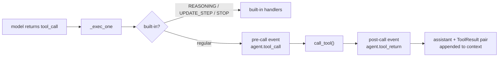

# Tool System

> **Concept page.** For hands-on usage see
> [Tutorial 2 — Add Tools](../tutorials/tools.md) and
> [Custom Tools — Advanced Patterns](../extensions-integration/tools.md).

## What Is a Tool

A tool is a **function with a JSON Schema**. The model never executes your
function — it generates a call request; the framework validates the arguments,
runs the function, and feeds the result back.

## Registration

Three ways to register a tool:

| Method                               | Schema source                       | Scope                |
| ------------------------------------ | ----------------------------------- | -------------------- |
| `@simple_tool`                       | Type hints + docstring              | Global (module load) |
| `@on_tools(schema)`                  | Explicit `FunctionDefinitionSchema` | Global (module load) |
| `ToolsManager` / `MultiToolsManager` | Manual                              | Per-session, runtime |

Handlers receive validated arguments as `dict` and return `str` — or a list of
content blocks when the result has to carry an image (the result the model
sees). See [Multimodal Tool Results](#multimodal-tool-results).

## Schemas and Validation

`FunctionPropertySchema` carries the JSON Schema constraints AmritaCore
forwards to the provider: `minimum` / `maximum` (plus `exclusiveMinimum` /
`exclusiveMaximum` / `multipleOf`), `minLength` / `maxLength`, `pattern`,
`enum`, `const`, `items` / `minItems` / `maxItems`, `default`, ... `required`
lives on the enclosing `FunctionParametersSchema`.

`amrita_core.tools.schema` treats that schema as an intermediate
representation with two orthogonal directions:

| Direction   | Entry points                                                              | Purpose                      |
| ----------- | ------------------------------------------------------------------------- | ---------------------------- |
| Projection  | `function_definition_from_pydantic`, `function_definition_from_signature` | Python types to a schema     |
| Compilation | `compile_parameters_model`                                                | A schema back to a validator |

The schema is what the **model** reads; the compiled Pydantic model is what
checks the **call**. Because compilation starts from the schema alone it covers
every source — a hand-written schema, `@simple_tool` type hints, and MCP
servers alike.

`call_tool()` runs the compiled validator before the handler, so a call that
violates the declared types or constraints raises `ValidationError` instead of
reaching your function with bad data. The agent loop turns that into an
`ERR: ...` tool result, so the model reads the field-level message and can fix
the call itself.

Two details worth knowing:

- Arguments the model omitted stay omitted, so a Python default on your
  handler still applies — validation never injects a `None` in their place.
- Set `function_config.validate_tool_arguments = False` to pass arguments
  through untouched.

### Describing a tool with one Pydantic model

`function_definition_from_pydantic` projects a model's fields, docstring,
constraints and defaults into a definition, so one declaration does both jobs:

```python
from pydantic import BaseModel, Field

from amrita_core.tools.manager import on_tools
from amrita_core.tools.schema import function_definition_from_pydantic


class LookupArgs(BaseModel):
    """Look a user up by id."""

    user_id: int = Field(description="Numeric user id", ge=1)
    verbose: bool = Field(default=False, description="Include history")


@on_tools(function_definition_from_pydantic(LookupArgs, name="lookup"))
async def lookup(args: dict) -> str:
    return f"user {args['user_id']}"
```

`ge=1` becomes `minimum: 1` in the schema the model sees, and the same bound is
enforced when the call comes back.

## Execution Path



- **Inline-handled tools** — `REASONING_TOOL` (`think_and_reason`),
  `UPDATE_STEP_TOOL` and `STOP_TOOL` (`agent_stop`) are dispatched inside
  `_exec_one` and therefore **bypass** the `agent.tool_call` /
  `agent.tool_return` events. `PROCESS_MESSAGE` (`processing_message`) is _not_
  one of them: it is a regular `custom_run` tool, gated by
  `function_config.agent_middle_message`, so it does go through the events.
  `REFLECTION_TOOL` is only ever used internally by the reflection pass. See
  [Built-ins](../builtins.md).
- **Stall guard**: if the same signature repeats `loop_reasoning_trigger`
  times, the call is cancelled _before_ execution and returns
  `"Cancelled: Reach the max limit of repeatly calling tool."`
- **Lifecycle events** let matchers rewrite arguments, cancel, rewrite results,
  or skip appending.

### Concurrent Tool Calls

The model may return several `tool_call`s in one response. Regular tools run
concurrently, but the context stays in one piece:

- **One assistant message** carries every `tool_call` of the round, in the order
  the model emitted them, with the provider's `reasoning_content` /
  `reasoning_signature` and any extra field copied back verbatim — the round trip
  has to be faithful for thinking-mode providers.
- **One `tool` message per call** follows immediately, in the same order, so every
  `tool_calls` entry has its matching result and nothing is interleaved.
- All results are collected **before** the batch is appended, so a slow tool
  cannot slip its message between another call and its result.

Splitting the batch — one assistant message per call — is not an option: it would
drop the model's reasoning from all but one message and leave providers looking at
an assistant `tool_calls` message whose results are missing.

Built-in flow-control tools (`think_and_reason`, `update_step`, `agent_stop`) are
ordered **after** regular tools and may append their own messages, so their side
effects never race with the batched results.

Concurrency is not unconditional. Every `ToolData` carries a `concurrency_safe`
flag (`bool`, or a `Callable` receiving the parsed arguments), default `True`. A
round is scanned in model order: consecutive safe calls share one pool, while each
unsafe call becomes a pool of one and a barrier between the calls around it. How
many calls of a pool may be in flight is capped by
`function_config.agent_tool_parallel_limit` (default `0` = unlimited, `1` = serial),
and a settled call immediately makes room for the next one.

Built-in tools and MCP tools always count as unsafe: the former rewrite the message
list or the output stream directly, the latter carry no trustworthy read/write
hint. A misclassification costs unnecessary serialisation rather than a race —
a raising classifier, a non-literal `True` return, unparseable arguments, and an
unregistered or disabled tool all fall on the unsafe side.

## Multimodal Tool Results

A handler may return content blocks instead of a string, so a tool can hand the
model an image — a screenshot, a rendered chart — alongside its text. The return
type is `TOOL_RESULT_CONTENT`: `str`, or `list[Content]`.

```python
from amrita_core import simple_tool
from amrita_core.types import Content, ImageContent, ImageUrl, TextContent


@simple_tool
async def screenshot(url: str) -> list[Content]:
    """Render a page and return it as an image.

    Args:
        url (str): page to capture
    """
    png = await capture(url)  # your own helper
    return [
        TextContent(text=f"captured {url}"),
        ImageContent(image_url=ImageUrl(url=f"data:image/png;base64,{png}")),
    ]
```

`simple_tool` passes a `list[Content]` through untouched. Every other return
value is still JSON-encoded into a string, so existing tools keep working.

`ToolResult.content` stores the list as it came back, and `.text` gives the
plain-text view — non-text blocks collapse into `<image>` / `<file:name>`
placeholders:

```python
result = ToolResult(
    role="tool", name="screenshot", content=blocks, tool_call_id=call.id
)
result.text  # "captured https://...<image>"
```

That text view is what logging, the `ERR:` check and compaction read; the blocks
themselves only leave the process on the wire. Use `content_text()` — or
`result.text` — anywhere you need the text-only form, rather than inspecting the
list yourself.

### Not every adapter can carry every block

Whether a block can be sent is a property of the **protocol**, not the model, so
adapters declare it in `features` (`FeatureFlag`):

| Field                    | Meaning                                               |
| ------------------------ | ----------------------------------------------------- |
| `input_multimodal`       | non-text blocks allowed in `user` / `system` content  |
| `tool_result_multimodal` | non-text blocks allowed in `tool` message content     |

`anthropic` sets both: its `tool_result` block takes a content array natively.
`openai` sets `tool_result_multimodal=False`, because a Chat Completions `tool`
message carries text only — an image there has to travel as a separate `user`
message, which the framework does not do on its own.

The gateway reads those flags before every request. Where a block cannot be
sent, it is swapped for a text notice on a **copy** of the message —
`<image omitted: the current adapter cannot carry it>` — and a warning is logged
once per protocol. The stored history is left alone, so a later fallback to a
stronger adapter still has the original blocks.

Preset fallback re-negotiates on every attempt, because the replacement preset
may speak a different protocol than the one that failed.

## Advanced: `custom_run` and `ToolContext`

Tools that need framework access use `custom_run` mode: the handler receives a
`ToolContext` with `.data` (arguments) and `.ctx` (the `StrategyContext`) —
useful for streaming progress or reading session state.

## Next

[Agent Strategy](agent-strategy.md) — who drives the tool loop.
