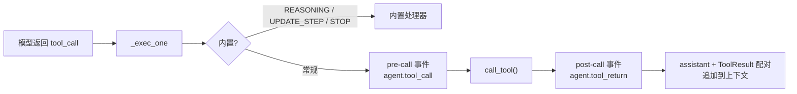

# 工具系统

> **概念页。** 实操见[教程 2——添加工具](../tutorials/tools.md)与
> [自定义工具——进阶模式](../extensions-integration/tools.md)。

## 什么是工具

工具是**带 JSON Schema 的函数**。模型从不执行你的函数——它生成调用请求；
框架解析参数、运行函数、把结果喂回。

## 注册

三种注册方式：

| 方式                                 | Schema 来源                     | 作用域           |
| ------------------------------------ | ------------------------------- | ---------------- |
| `@simple_tool`                       | 类型注解 + docstring            | 全局（模块加载） |
| `@on_tools(schema)`                  | 显式 `FunctionDefinitionSchema` | 全局（模块加载） |
| `ToolsManager` / `MultiToolsManager` | 手动                            | 每会话、运行时   |

handler 接收已解析的参数 `dict` 并返回 `str`——需要携带图片时改返回内容块列表
（模型看到的结果）。见[多模态工具结果](#多模态工具结果)。

## Schema 与校验

`FunctionPropertySchema` 携带 AmritaCore 转发给 provider 的 JSON Schema 约束：
`minimum` / `maximum`（以及 `exclusiveMinimum` / `exclusiveMaximum` /
`multipleOf`）、`minLength` / `maxLength`、`pattern`、`enum`、`const`、
`items` / `minItems` / `maxItems`、`default` 等。`required` 位于外层的
`FunctionParametersSchema` 上。

`amrita_core.tools.schema` 把这个 schema 当作中间表示，提供两个正交方向：

| 方向 | 入口                                                                      | 用途                 |
| ---- | ------------------------------------------------------------------------- | -------------------- |
| 投影 | `function_definition_from_pydantic`、`function_definition_from_signature` | Python 类型 → schema |
| 编译 | `compile_parameters_model`                                                | schema → 校验器      |

schema 是给**模型**读的；编译出的 Pydantic 模型负责校验**调用**。因为编译只从
schema 出发，所以它对所有来源都成立——手写 schema、`@simple_tool` 的类型注解、
以及 MCP 服务器。

`call_tool()` 在 handler 之前运行编译出的校验器，因此违反声明类型或约束的调用
会抛 `ValidationError`，而不是带着坏数据抵达你的函数。Agent 循环会把它转成
`ERR: ...` 工具结果，模型就能读到字段级报错并自行修正调用。

两个值得知道的细节：

- 模型省略的参数保持省略，因此你的 handler 上的 Python 默认值仍然生效——校验
  不会塞一个 `None` 进去顶替它。
- 设 `function_config.validate_tool_arguments = False` 可原样传递参数。

### 用一个 Pydantic 模型描述工具

`function_definition_from_pydantic` 会把模型的字段、docstring、约束与默认值投影
成一份定义，因此一处声明同时完成两件事：

```python
from pydantic import BaseModel, Field

from amrita_core.tools.manager import on_tools
from amrita_core.tools.schema import function_definition_from_pydantic


class LookupArgs(BaseModel):
    """Look a user up by id."""

    user_id: int = Field(description="Numeric user id", ge=1)
    verbose: bool = Field(default=False, description="Include history")


@on_tools(function_definition_from_pydantic(LookupArgs, name="lookup"))
async def lookup(args: dict) -> str:
    return f"user {args['user_id']}"
```

`ge=1` 会变成模型看到的 schema 里的 `minimum: 1`，同一个边界在调用回来时也会被
强制执行。

## 执行路径



- **内联处理工具**——`REASONING_TOOL`（`think_and_reason`）、`UPDATE_STEP_TOOL`
  与 `STOP_TOOL`（`agent_stop`）在 `_exec_one` 内直接分派，因此**绕过**
  `agent.tool_call` / `agent.tool_return` 事件。`PROCESS_MESSAGE`
  （`processing_message`）**不属于**这一类：它是常规的 `custom_run` 工具，由
  `function_config.agent_middle_message` 开关控制，因此会经过事件。
  `REFLECTION_TOOL` 只在反思阶段内部使用。见[内置能力](../builtins.md)。
- **停滞护栏**：相同签名重复 `loop_reasoning_trigger` 次时，调用在**执行前**
  被取消，返回 `"Cancelled: Reach the max limit of repeatly calling tool."`
- **生命周期事件**让 matcher 改写参数、取消、改写结果或跳过追加。

### 并发工具调用

模型可能在一个响应里返回多个 `tool_call`。常规工具并发执行，但上下文始终是完整的一块：

- **一条 assistant 消息**承载该轮的**全部** `tool_call`，顺序与模型发出的一致，
  并把 provider 的 `reasoning_content` / `reasoning_signature` 及任何额外字段原样
  回填——对 thinking 模式的 provider 来说，这个往返必须忠实。
- **每个调用一条 `tool` 消息**紧随其后，顺序相同，因此每个 `tool_calls` 条目都有
  对应的结果，中间不插入任何东西。
- 全部结果收集完毕**之后**才追加整批，因此慢工具无法把自己的消息插进另一个调用与
  其结果之间。

把这一批拆开——每个调用一条 assistant 消息——不是一个选项：那会让除一条之外的所有
消息都丢掉模型的推理，并让 provider 看到一条缺少结果的 assistant `tool_calls` 消息。

内置控制流工具（`think_and_reason`、`update_step`、`agent_stop`）排在常规工具
**之后**，它们可以追加自己的消息，因此其副作用永远不会与成批结果竞争。

并发不是无条件的。每个 `ToolData` 带一个 `concurrency_safe` 标记（`bool`，或接收
已解析参数的 `Callable`），默认 `True`。调度时按模型顺序扫描这一轮调用：连续的
安全调用归一池，每个不安全的调用单独成池，并成为它前后调用之间的屏障。池内同时在飞
的调用数由 `function_config.agent_tool_parallel_limit` 限制（默认 `0` = 不限，
`1` 即串行），一个调用结算就立即补入下一个。

内置工具与 MCP 工具始终按不安全处理：前者直接改写消息列表或输出流，后者的 schema
里没有可信的读写提示。标错方向的代价是不必要的串行，而不是竞态——分类器抛错、返回
非字面 `True`、参数无法解析、工具未注册或已禁用，都会落到不安全一侧。

## 多模态工具结果

handler 可以返回内容块而非字符串，于是工具能在文本之外交给模型一张图——截图、
渲染出的图表等。返回类型是 `TOOL_RESULT_CONTENT`：`str` 或 `list[Content]`。

```python
from amrita_core import simple_tool
from amrita_core.types import Content, ImageContent, ImageUrl, TextContent


@simple_tool
async def screenshot(url: str) -> list[Content]:
    """Render a page and return it as an image.

    Args:
        url (str): page to capture
    """
    png = await capture(url)  # 你自己的实现
    return [
        TextContent(text=f"captured {url}"),
        ImageContent(image_url=ImageUrl(url=f"data:image/png;base64,{png}")),
    ]
```

`simple_tool` 会把 `list[Content]` 原样透传。其余返回值仍会被 JSON 编码成字符串，
因此已有工具不受影响。

`ToolResult.content` 原样保存这个列表，`.text` 给出纯文本视图——非文本块折算成
`<image>` / `<file:name>` 占位：

```python
result = ToolResult(
    role="tool", name="screenshot", content=blocks, tool_call_id=call.id
)
result.text  # "captured https://...<image>"
```

日志、`ERR:` 判错与历史压缩读的都是这个文本视图；内容块本身只在请求里离开进程。
需要纯文本形态时用 `content_text()` 或 `result.text`，不要自己去翻那个列表。

### 并非每个适配器都能携带每种块

一个块能否发出去是**协议**的属性，不是模型的属性，因此由适配器在 `features`
（`FeatureFlag`）里声明：

| 字段                     | 含义                                       |
| ------------------------ | ------------------------------------------ |
| `input_multimodal`       | 非文本块可否出现在 `user` / `system` 内容里 |
| `tool_result_multimodal` | 非文本块可否出现在 `tool` 消息内容里        |

`anthropic` 两项都为真：它的 `tool_result` 块原生接收内容数组。
`openai` 的 `tool_result_multimodal` 为 `False`，因为 Chat Completions 的 `tool`
消息只承载文本——那里的图片得另发一条 `user` 消息，框架不会代劳。

网关在每次请求前读这些标记。发不出去的块会在消息的**副本**上换成文本说明
——`<image omitted: the current adapter cannot carry it>`——并按协议各记一条
warning。存储侧的历史保持原样，因此后续回退到更强的适配器时，原始块还在。

preset 回退时每次尝试都会重新协商，因为替换后的 preset 可能说的是另一种协议。

## 进阶：`custom_run` 与 `ToolContext`

需要框架访问的工具使用 `custom_run` 模式：handler 接收 `ToolContext`
（含 `.data` 参数与 `.ctx` 即 `StrategyContext`）——适合流式进度或读取
会话状态。

## 下一步

[Agent 策略](agent-strategy.md)——谁驱动工具循环。
